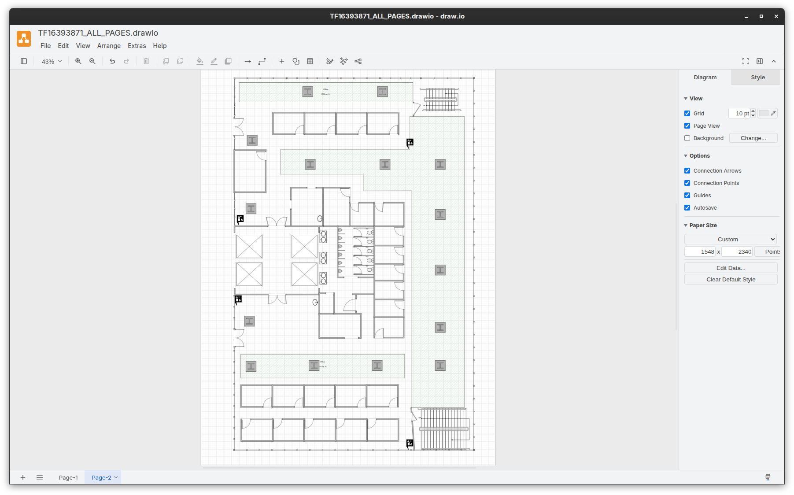

# Microsoft Visio to draw.io converter

[](https://github.com/skhell/visio-to-drawio/releases)
[](LICENSE)

**Turn a whole Visio document into one editable, multi-page draw.io file with a single command.**

`visiodrawio` converts Microsoft Visio drawings (`.vsdx`) and templates
(`.vstx`) into native [draw.io / diagrams.net](https://www.drawio.com)
diagrams. Every Visio page becomes a tab in the same `.drawio` file.
Shapes stay real draw.io shapes you can move, restyle and edit, not a
flat picture of the page.



> [!NOTE]
> A two-page office floor plan template (`testdata/tf16393871.vstx`)
> from Microsoft's [featured Visio templates and diagrams](https://support.microsoft.com/en-us/visio/featured-visio-templates-and-diagrams)
> page converted to draw-io with `visiodrawio tf16393871.vstx`.


## Why use it

- **Whole documents, not single pages.** One run converts every
  foreground page and writes them into a single multi-page `.drawio`
  file. Each page also gets its own file, in case you only need
  one diagram.
- **Editable output.** Geometry, text formatting, fills and gradients,
  fill patterns, line styles, arrowheads, rotation, flips, groups and
  images become native draw.io cells.
- **Layers and backgrounds kept.** Visio layers map to draw.io layers,
  and hidden layers stay hidden but can be switched on.
  Background pages are merged in as locked layers.
- **Shows what was approximated.** Each page gets a CSV report of the 
  converted shapes, and warnings go to stderr so you know what to check.
- **Local and private.** A single static Go binary. It needs neither
  Visio nor draw.io, and makes no network calls.
- **Works for AI assistants too.** It ships a built-in
  [MCP](https://modelcontextprotocol.io) server and a Claude Code plugin.

> [!NOTE]
> Legacy binary `.vsd` files are not supported. Open them in Visio and
> use **Save As -> .vsdx** first.

## Quick start

```sh
go install github.com/skhell/visio-to-drawio/cmd/visiodrawio@latest
visiodrawio yourfile.vsdx # or yourfile.vstx or even *.vsdx *.vstx
```

## What you get

An organized directory per single file with one draw.io file containing
all the pages exactly as appear your Visio file (in case of multi-page
document), `single-pages` directory containing single pages export and
a `report` directory making easy to understand the conversion report.

```text
yourfile/
├── YOURFILE_ALL_PAGES.drawio    # every page in one multi-page file (one tab per Visio page)
├── single-pages/
│   ├── PAGE_1.drawio            # one file per page named like your Visio file
│   └── PAGE_2.drawio
└── report/
    ├── PAGE_1.csv               # conversion report
    └── PAGE_2.csv
```

## Install

**Prebuilt binaries** for Linux, macOS and Windows are attached to every [GitHub release](https://github.com/skhell/visio-to-drawio/releases).

**With Go:**

If you don't have Go installed [please follow the instructions here.](https://go.dev/dl/)

```sh
# if you have Go installed in your OS
go install github.com/skhell/visio-to-drawio/cmd/visiodrawio@latest
```

**From source:**

```sh
git clone https://github.com/skhell/visio-to-drawio
cd visio-to-drawio
go install ./cmd/visiodrawio
```

## CLI usage

```sh
visiodrawio yourfile.vsdx                 # all pages, output in ./yourfile/
visiodrawio -o out network.vsdx           # choose the output folder
visiodrawio -list yourfile.vsdx           # list pages and exit
visiodrawio -page "Core" yourfile.vsdx    # convert a single page
visiodrawio a.vsdx b.vstx -o out -force   # several files, overwrite existing output
```

`visiodrawio` support the following flags:

| Flag | Description |
|------|-------------|
| `-o DIR` | Output folder (default: folder named after the input file) |
| `-force` | Overwrite existing output files |
| `-page NAME` | Convert only this page (name, unique name or ID) |
| `-list` | List pages and exit |
| `-nofit` | Do not shrink text that would overflow its box |
| `-splitlayers` | Keep every visible Visio layer as its own draw.io layer |
| `-hidelayer A,B` | Keep the named Visio layers as separate, hidden draw.io layers |
| `-bgeditable` | Leave background layers unlocked |
| `-nobg` | Do not include BackPage background layers |
| `-version` | Print the version |

## Use it from AI assistants

`visiodrawio mcp` start an MCP server over stdio that exposes two tools:

| Tool | Purpose |
|------|---------|
| `list_pages` | List the foreground pages of a `.vsdx` file |
| `convert` | Convert a `.vsdx`/`.vstx` file (all pages or one) to `.drawio` and return the written files |

Everything runs locally, and files are never uploaded anywhere.
Ask your assistant something like **convert my `microsoft-visio-diagram.vsdx` to draw.io**.

### Claude Code

```text
/plugin marketplace add skhell/visio-to-drawio
/plugin install visiodrawio@visiodrawio
```

The plugin registers the MCP server and a skill that teaches Claude when
and how to convert diagrams. It needs the `visiodrawio` binary on
your `PATH` (see [Install](#install)).

### Claude Desktop, Codex CLI, GitHub Copilot, Cursor and other MCP clients

Add the server to your client's MCP configuration:

```json
{
  "mcpServers": {
    "visiodrawio": {
      "command": "visiodrawio",
      "args": ["mcp"]
    }
  }
}
```

Codex CLI (`~/.codex/config.toml`):

```toml
[mcp_servers.visiodrawio]
command = "visiodrawio"
args = ["mcp"]
```

To confine the server to a directory tree, set `VISIODRAWIO_ROOT`.
Input and output paths outside it are rejected:

```json
{ "command": "visiodrawio", "args": ["mcp"], "env": { "VISIODRAWIO_ROOT": "/home/youruser/diagrams" } }
```

## Limitations

- Only the Open Packaging formats `.vsdx` and `.vstx` are supported,
  not `.vsd`, and not `.vsdm` with macros.
- Some Visio features have no draw.io equivalent and are approximated.
  For example, Visio fill patterns become a draw.io hatch fill.
  Check the per-page CSV report and the warnings printed on stderr.
- Visio shape formulas are not evaluated. The converter uses the values
  Visio saved in the file, which match what Visio last displayed.
- Text auto-fitting is heuristic.
  Use `-nofit` if you prefer unscaled text.

## Contributing

If you improve the code test before release:

```sh
go test ./...
go vet ./...
go build ./cmd/visiodrawio
```

See [CONTRIBUTING.md](CONTRIBUTING.md).
Report vulnerabilities as described in [SECURITY.md](SECURITY.md).

## License

[MIT](LICENSE). The MIT license covers this project's source code only.
It does not cover third-party sample diagrams or images
derived from them.

Visio is a trademark of Microsoft Corporation; draw.io is a trademark of
JGraph Ltd. This project is not affiliated with or endorsed by either.
